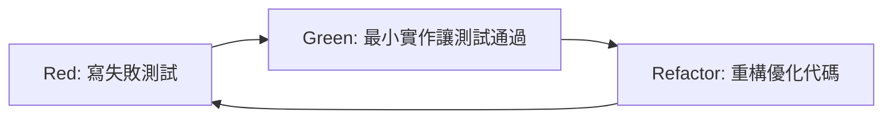

# TDD Multi-Repository Implementation Specification

## 1. 概述

本文件定義了使用測試驅動開發 (TDD) 方法實作多儲存庫功能的詳細規範。包含測試案例設計、實作步驟和驗證標準。

**目標讀者**: 開發團隊、測試工程師

## 2. TDD 實作流程

### 2.1 TDD 循環



### 2.2 實作階段劃分

1. **Phase 1**: Repository Name Normalization
2. **Phase 2**: Multi-Collection ChromaDB Client  
3. **Phase 3**: Multi-Label Neo4j Service
4. **Phase 4**: Repository Metadata Management
5. **Phase 5**: Multi-Repository Use Cases
6. **Phase 6**: API Endpoints Integration

## 3. Phase 1: Repository Name Normalization

### 3.1 測試案例 (test_repository_name_normalization.py)

```python
import pytest
from src.infrastructure.repository_utils import RepositoryNameNormalizer

class TestRepositoryNameNormalizer:
    
    def test_normalize_github_url_to_name(self):
        """Test converting GitHub URL to repository name"""
        normalizer = RepositoryNameNormalizer()
        
        # Red: Test will fail initially
        assert normalizer.url_to_name("https://github.com/user/repo-name") == "user/repo-name"
        assert normalizer.url_to_name("https://github.com/org/my.project") == "org/my.project"
        assert normalizer.url_to_name("git@github.com:user/private-repo.git") == "user/private-repo"
    
    def test_normalize_name_for_collection(self):
        """Test normalizing repository name for ChromaDB collection"""
        normalizer = RepositoryNameNormalizer()
        
        # Red: Test will fail initially  
        assert normalizer.to_collection_name("user/repo-name") == "repo_user_repo_name"
        assert normalizer.to_collection_name("org/my.project") == "repo_org_my_project"
        assert normalizer.to_collection_name("test-user/test_repo") == "repo_test_user_test_repo"
    
    def test_normalize_name_for_neo4j_label(self):
        """Test normalizing repository name for Neo4j label"""
        normalizer = RepositoryNameNormalizer()
        
        # Red: Test will fail initially
        assert normalizer.to_neo4j_label("user/repo-name") == "Repo_user_repo_name"
        assert normalizer.to_neo4j_label("org/my.project") == "Repo_org_my_project"
    
    def test_invalid_repository_names(self):
        """Test handling of invalid repository names"""
        normalizer = RepositoryNameNormalizer()
        
        with pytest.raises(ValueError):
            normalizer.url_to_name("invalid-url")
        
        with pytest.raises(ValueError):
            normalizer.to_collection_name("")
        
        with pytest.raises(ValueError):
            normalizer.to_collection_name("repo-without-owner")

    def test_reverse_normalization(self):
        """Test converting normalized names back to original format"""
        normalizer = RepositoryNameNormalizer()
        
        original = "user/repo-name"
        collection_name = normalizer.to_collection_name(original)
        neo4j_label = normalizer.to_neo4j_label(original)
        
        assert normalizer.from_collection_name(collection_name) == original
        assert normalizer.from_neo4j_label(neo4j_label) == original
```

### 3.2 預期實作 (src/infrastructure/repository_utils.py)

```python
import re
from typing import Optional
from urllib.parse import urlparse

class RepositoryNameNormalizer:
    """Utility class for normalizing repository names across different storage systems"""
    
    @staticmethod
    def url_to_name(url: str) -> str:
        """Convert repository URL to standard name format (owner/repo)"""
        # Implementation will be driven by tests
        pass
    
    @staticmethod  
    def to_collection_name(repo_name: str) -> str:
        """Convert repository name to ChromaDB collection name"""
        # Implementation will be driven by tests
        pass
    
    @staticmethod
    def to_neo4j_label(repo_name: str) -> str:
        """Convert repository name to Neo4j label"""
        # Implementation will be driven by tests
        pass
```

## 4. Phase 2: Multi-Collection ChromaDB Client

### 4.1 測試案例 (test_multi_repo_chroma_client.py)

```python
import pytest
import tempfile
import shutil
from src.domain.entities.code_chunk import CodeChunk
from src.infrastructure.database.multi_repo_chroma_client import MultiRepoChromaDBClient

class TestMultiRepoChromaDBClient:
    
    @pytest.fixture
    def temp_db_path(self):
        temp_dir = tempfile.mkdtemp()
        yield temp_dir
        shutil.rmtree(temp_dir)
    
    @pytest.fixture
    def client(self, temp_db_path):
        return MultiRepoChromaDBClient(path=temp_db_path)
    
    @pytest.fixture
    def sample_chunk(self):
        return CodeChunk(
            id="test-chunk-1",
            file_path="src/main.py",
            content="def hello(): return 'world'",
            embedding=[0.1, 0.2, 0.3],
            metadata={"language": "python"}
        )
    
    def test_add_chunk_to_specific_repository(self, client, sample_chunk):
        """Test adding code chunk to specific repository collection"""
        repo_name = "user/test-repo"
        
        # Red: This will fail initially
        client.add(sample_chunk, repo_name)
        
        # Verify chunk was added to correct collection
        results = client.query("hello", repo_name, top_k=1)
        assert len(results) == 1
        assert results[0]["content"] == sample_chunk.content
    
    def test_query_specific_repository(self, client, sample_chunk):
        """Test querying chunks from specific repository"""
        repo1 = "user/repo1"
        repo2 = "user/repo2"
        
        # Add same chunk to different repositories
        client.add(sample_chunk, repo1)
        sample_chunk.id = "test-chunk-2"  # Change ID to avoid conflicts
        client.add(sample_chunk, repo2)
        
        # Query specific repository
        results1 = client.query("hello", repo1, top_k=10)
        results2 = client.query("hello", repo2, top_k=10)
        
        assert len(results1) == 1
        assert len(results2) == 1
        # Results should be from different collections
    
    def test_list_repositories(self, client, sample_chunk):
        """Test listing all repositories with data"""
        repos = ["user/repo1", "user/repo2", "org/project"]
        
        for repo in repos:
            sample_chunk.id = f"chunk-{repo.replace('/', '-')}"
            client.add(sample_chunk, repo)
        
        # Red: This will fail initially
        available_repos = client.list_repositories()
        assert set(available_repos) == set(repos)
    
    def test_delete_repository_collection(self, client, sample_chunk):
        """Test deleting entire repository collection"""
        repo_name = "user/temp-repo"
        
        client.add(sample_chunk, repo_name)
        assert repo_name in client.list_repositories()
        
        # Red: This will fail initially
        client.delete_repository(repo_name)
        assert repo_name not in client.list_repositories()
    
    def test_get_repository_stats(self, client):
        """Test getting repository statistics"""
        repo_name = "user/stats-repo"
        
        # Add multiple chunks
        for i in range(5):
            chunk = CodeChunk(
                id=f"chunk-{i}",
                file_path=f"src/file{i}.py",
                content=f"def func{i}(): pass",
                embedding=[0.1 * i, 0.2 * i, 0.3 * i],
                metadata={"language": "python"}
            )
            client.add(chunk, repo_name)
        
        # Red: This will fail initially
        stats = client.get_repository_stats(repo_name)
        assert stats["chunk_count"] == 5
        assert stats["repository_name"] == repo_name
    
    def test_repository_isolation(self, client, sample_chunk):
        """Test that repositories are completely isolated"""
        repo1 = "user/isolated1"
        repo2 = "user/isolated2"
        
        # Add chunk only to repo1
        client.add(sample_chunk, repo1)
        
        # Query repo2 should return no results
        results = client.query("hello", repo2, top_k=10)
        assert len(results) == 0
        
        # Query repo1 should return results
        results = client.query("hello", repo1, top_k=10)
        assert len(results) == 1
```

### 4.2 預期實作 (src/infrastructure/database/multi_repo_chroma_client.py)

```python
from typing import List, Dict, Any
import chromadb
from chromadb.api.models.Collection import Collection
from src.domain.entities.code_chunk import CodeChunk
from src.infrastructure.repository_utils import RepositoryNameNormalizer

class MultiRepoChromaDBClient:
    """ChromaDB client supporting multiple repository collections"""
    
    def __init__(self, path: str = "./data/chroma_db"):
        self.client = chromadb.PersistentClient(path=path)
        self._collections: Dict[str, Collection] = {}
        self._normalizer = RepositoryNameNormalizer()
    
    def add(self, chunk: CodeChunk, repository_name: str) -> None:
        """Add chunk to specific repository collection"""
        # Implementation will be driven by tests
        pass
    
    def query(self, query: str, repository_name: str, top_k: int = 5) -> List[Dict[str, Any]]:
        """Query chunks from specific repository"""
        # Implementation will be driven by tests
        pass
```

## 5. Phase 3: Multi-Label Neo4j Service

### 5.1 測試案例 (test_multi_repo_neo4j_service.py)

```python
import pytest
from src.domain.entities.graph_entities import FileNode, FunctionNode, CallsEdge
from src.infrastructure.database.multi_repo_neo4j_service import MultiRepoNeo4jService

class TestMultiRepoNeo4jService:
    
    @pytest.fixture
    def service(self):
        # Use test database
        return MultiRepoNeo4jService(
            uri="bolt://localhost:7687",
            user="neo4j", 
            password="password123"
        )
    
    @pytest.fixture
    def sample_file_node(self):
        return FileNode(
            name="main.py",
            path="src/main.py",
            properties={"language": "python", "lines": 50}
        )
    
    @pytest.fixture  
    def sample_function_node(self):
        return FunctionNode(
            name="hello_world",
            properties={"parameters": [], "return_type": "str"}
        )
    
    def test_add_node_with_repository_label(self, service, sample_file_node):
        """Test adding node with repository-specific label"""
        repo_name = "user/test-repo"
        
        # Red: This will fail initially
        service.add_node(sample_file_node, repo_name)
        
        # Verify node has both original labels and repository label
        nodes = service.query_nodes_by_repository(repo_name)
        assert len(nodes) == 1
        assert "Repo_user_test_repo" in nodes[0]["labels"]
        assert "File" in nodes[0]["labels"]
    
    def test_query_nodes_by_repository(self, service, sample_file_node, sample_function_node):
        """Test querying nodes from specific repository"""
        repo1 = "user/repo1"
        repo2 = "user/repo2"
        
        service.add_node(sample_file_node, repo1)
        service.add_node(sample_function_node, repo2)
        
        # Red: This will fail initially
        repo1_nodes = service.query_nodes_by_repository(repo1)
        repo2_nodes = service.query_nodes_by_repository(repo2)
        
        assert len(repo1_nodes) == 1
        assert len(repo2_nodes) == 1
        assert repo1_nodes[0]["name"] == "main.py"
        assert repo2_nodes[0]["name"] == "hello_world"
    
    def test_add_edge_with_repository_context(self, service, sample_file_node, sample_function_node):
        """Test adding edge between nodes in same repository"""
        repo_name = "user/edge-repo"
        
        service.add_node(sample_file_node, repo_name)
        service.add_node(sample_function_node, repo_name)
        
        edge = CallsEdge(
            source=sample_file_node,
            target=sample_function_node,
            properties={"line_number": 10}
        )
        
        # Red: This will fail initially
        service.add_edge(edge, repo_name)
        
        # Verify edge exists with repository context
        edges = service.query_edges_by_repository(repo_name)
        assert len(edges) == 1
    
    def test_clear_repository_data(self, service, sample_file_node):
        """Test clearing data for specific repository only"""
        repo1 = "user/keep-repo"
        repo2 = "user/clear-repo"
        
        service.add_node(sample_file_node, repo1)
        sample_file_node.name = "other.py"
        service.add_node(sample_file_node, repo2)
        
        # Red: This will fail initially
        service.clear_repository(repo2)
        
        # Verify repo1 data still exists, repo2 data is gone
        repo1_nodes = service.query_nodes_by_repository(repo1)
        repo2_nodes = service.query_nodes_by_repository(repo2)
        
        assert len(repo1_nodes) == 1
        assert len(repo2_nodes) == 0
    
    def test_repository_isolation(self, service, sample_file_node):
        """Test that repositories are completely isolated"""
        repo1 = "user/isolated1"  
        repo2 = "user/isolated2"
        
        service.add_node(sample_file_node, repo1)
        
        # Query for specific repository should only return its nodes
        repo1_nodes = service.query_nodes_by_repository(repo1)
        repo2_nodes = service.query_nodes_by_repository(repo2)
        
        assert len(repo1_nodes) == 1
        assert len(repo2_nodes) == 0
```

## 6. Phase 4: Repository Metadata Management  

### 6.1 測試案例 (test_repository_metadata_service.py)

```python
import pytest
from datetime import datetime
from src.domain.entities.repository_metadata import RepositoryMetadata, RepositoryStatus
from src.infrastructure.metadata.repository_metadata_service import RepositoryMetadataService

class TestRepositoryMetadataService:
    
    @pytest.fixture
    def service(self, tmp_path):
        return RepositoryMetadataService(metadata_dir=str(tmp_path))
    
    @pytest.fixture
    def sample_metadata(self):
        return RepositoryMetadata(
            name="user/test-repo",
            display_name="Test Repository",
            url="https://github.com/user/test-repo",
            status=RepositoryStatus.INDEXED,
            file_count=100,
            chunk_count=500
        )
    
    def test_save_and_load_metadata(self, service, sample_metadata):
        """Test saving and loading repository metadata"""
        # Red: This will fail initially
        service.save_metadata(sample_metadata)
        
        loaded = service.get_metadata("user/test-repo")
        assert loaded is not None
        assert loaded.name == sample_metadata.name
        assert loaded.status == sample_metadata.status
    
    def test_list_all_repositories(self, service):
        """Test listing all repository metadata"""
        repos = [
            RepositoryMetadata(name="user/repo1", display_name="Repo 1", 
                             url="https://github.com/user/repo1"),
            RepositoryMetadata(name="user/repo2", display_name="Repo 2",
                             url="https://github.com/user/repo2")
        ]
        
        for repo in repos:
            service.save_metadata(repo)
        
        # Red: This will fail initially
        all_repos = service.list_repositories()
        assert len(all_repos) == 2
        assert {repo.name for repo in all_repos} == {"user/repo1", "user/repo2"}
    
    def test_update_metadata(self, service, sample_metadata):
        """Test updating existing metadata"""
        service.save_metadata(sample_metadata)
        
        # Update status
        sample_metadata.status = RepositoryStatus.ERROR
        sample_metadata.error_message = "Indexing failed"
        
        # Red: This will fail initially  
        service.update_metadata(sample_metadata)
        
        updated = service.get_metadata("user/test-repo")
        assert updated.status == RepositoryStatus.ERROR
        assert updated.error_message == "Indexing failed"
    
    def test_delete_metadata(self, service, sample_metadata):
        """Test deleting repository metadata"""
        service.save_metadata(sample_metadata)
        assert service.get_metadata("user/test-repo") is not None
        
        # Red: This will fail initially
        service.delete_metadata("user/test-repo")
        assert service.get_metadata("user/test-repo") is None
    
    def test_get_repositories_by_status(self, service):
        """Test filtering repositories by status"""
        repos = [
            RepositoryMetadata(name="user/indexed", display_name="Indexed", 
                             url="https://github.com/user/indexed", status=RepositoryStatus.INDEXED),
            RepositoryMetadata(name="user/indexing", display_name="Indexing",
                             url="https://github.com/user/indexing", status=RepositoryStatus.INDEXING),
            RepositoryMetadata(name="user/error", display_name="Error",
                             url="https://github.com/user/error", status=RepositoryStatus.ERROR)
        ]
        
        for repo in repos:
            service.save_metadata(repo)
        
        # Red: This will fail initially
        indexed_repos = service.get_repositories_by_status(RepositoryStatus.INDEXED)
        assert len(indexed_repos) == 1
        assert indexed_repos[0].name == "user/indexed"
```

## 7. Phase 5: Multi-Repository Use Cases

### 7.1 測試案例 (test_multi_repo_index_repository_use_case.py)

```python
import pytest
from unittest.mock import Mock, AsyncMock
from src.application.use_cases.multi_repo_index_repository import MultiRepoIndexRepositoryUseCase

class TestMultiRepoIndexRepositoryUseCase:
    
    @pytest.fixture
    def mock_dependencies(self):
        return {
            'file_processor': Mock(),
            'text_splitter': Mock(),
            'embedding_client': AsyncMock(),
            'code_repository': Mock(),
            'graph_repository': Mock(), 
            'code_parser': Mock(),
            'metadata_service': Mock()
        }
    
    @pytest.fixture
    def use_case(self, mock_dependencies):
        return MultiRepoIndexRepositoryUseCase(**mock_dependencies)
    
    @pytest.mark.asyncio
    async def test_index_new_repository(self, use_case, mock_dependencies):
        """Test indexing a new repository"""
        repo_url = "https://github.com/user/new-repo"
        repo_name = "user/new-repo"
        
        # Setup mocks
        mock_dependencies['file_processor'].read_files.return_value = {
            "src/main.py": "def hello(): pass"
        }
        mock_dependencies['metadata_service'].repository_exists.return_value = False
        
        # Red: This will fail initially
        result = await use_case.execute(repo_url, include_dirs=["src/"])
        
        # Verify repository was indexed
        assert result["repository_name"] == repo_name
        assert result["status"] == "completed"
        
        # Verify dependencies were called correctly
        mock_dependencies['code_repository'].add.assert_called()
        mock_dependencies['graph_repository'].add_node.assert_called()
        mock_dependencies['metadata_service'].save_metadata.assert_called()
    
    @pytest.mark.asyncio
    async def test_reindex_existing_repository(self, use_case, mock_dependencies):
        """Test reindexing an existing repository"""
        repo_url = "https://github.com/user/existing-repo"
        
        mock_dependencies['metadata_service'].repository_exists.return_value = True
        
        # Red: This will fail initially
        result = await use_case.execute(repo_url, force_reindex=True)
        
        # Verify old data was cleared before reindexing
        mock_dependencies['code_repository'].delete_repository.assert_called()
        mock_dependencies['graph_repository'].clear_repository.assert_called()
    
    @pytest.mark.asyncio
    async def test_index_repository_with_error(self, use_case, mock_dependencies):
        """Test handling errors during indexing"""
        repo_url = "https://github.com/user/error-repo"
        
        # Simulate error in file processing
        mock_dependencies['file_processor'].read_files.side_effect = Exception("File access error")
        
        # Red: This will fail initially
        result = await use_case.execute(repo_url)
        
        assert result["status"] == "error"
        assert "error" in result["message"]
        
        # Verify error was recorded in metadata
        mock_dependencies['metadata_service'].save_metadata.assert_called()
        saved_metadata = mock_dependencies['metadata_service'].save_metadata.call_args[0][0]
        assert saved_metadata.status == RepositoryStatus.ERROR
```

## 8. Phase 6: API Endpoints Integration

### 8.1 測試案例 (test_multi_repo_api_endpoints.py)

```python
import pytest
from fastapi.testclient import TestClient
from src.presentation.api.main import app

class TestMultiRepoAPIEndpoints:
    
    @pytest.fixture
    def client(self):
        return TestClient(app)
    
    def test_list_repositories_endpoint(self, client):
        """Test GET /api/v1/repositories"""
        # Red: This will fail initially
        response = client.get("/api/v1/repositories")
        
        assert response.status_code == 200
        data = response.json()
        assert "repositories" in data
        assert "total_count" in data
    
    def test_index_repository_endpoint(self, client):
        """Test POST /api/v1/repositories"""
        payload = {
            "url": "https://github.com/user/test-repo",
            "include_dirs": ["src/"],
            "force_reindex": False
        }
        
        # Red: This will fail initially
        response = client.post("/api/v1/repositories", json=payload)
        
        assert response.status_code == 201
        data = response.json()
        assert data["repository_name"] == "user/test-repo"
        assert data["status"] == "indexing_started"
    
    def test_query_single_repository_endpoint(self, client):
        """Test POST /api/v1/repositories/{repo_name}/query"""
        payload = {
            "query": "How does authentication work?",
            "search_type": "hybrid",
            "top_k": 5
        }
        
        # Red: This will fail initially
        response = client.post("/api/v1/repositories/user/test-repo/query", json=payload)
        
        assert response.status_code == 200
        data = response.json()
        assert "code_results" in data
        assert "repositories_searched" in data
        assert len(data["repositories_searched"]) == 1
    
    def test_multi_repository_query_endpoint(self, client):
        """Test POST /api/v1/query"""
        payload = {
            "query": "How does authentication work?",
            "scope": "multiple",
            "repositories": ["user/repo1", "user/repo2"],
            "search_type": "hybrid"
        }
        
        # Red: This will fail initially
        response = client.post("/api/v1/query", json=payload)
        
        assert response.status_code == 200
        data = response.json()
        assert len(data["repositories_searched"]) == 2
    
    def test_delete_repository_endpoint(self, client):
        """Test DELETE /api/v1/repositories/{repo_name}"""
        # Red: This will fail initially
        response = client.delete("/api/v1/repositories/user/test-repo")
        
        assert response.status_code == 200
        data = response.json()
        assert data["deleted"] is True
```

## 9. Integration Tests

### 9.1 End-to-End Test Suite

```python
import pytest
import tempfile
import shutil
from src.application.use_cases.multi_repo_index_repository import MultiRepoIndexRepositoryUseCase
from src.application.use_cases.multi_repo_answer_question import MultiRepoAnswerQuestionUseCase

class TestMultiRepositoryIntegration:
    
    @pytest.fixture
    def temp_environment(self):
        """Setup temporary test environment"""
        temp_dir = tempfile.mkdtemp()
        # Setup test repositories, databases, etc.
        yield temp_dir
        shutil.rmtree(temp_dir)
    
    @pytest.mark.integration
    @pytest.mark.asyncio
    async def test_full_multi_repo_workflow(self, temp_environment):
        """Test complete workflow: index multiple repos, query across them"""
        # This test will verify the entire multi-repository system works end-to-end
        pass
```

## 10. Performance Tests

### 10.1 Multi-Repository Performance Benchmarks

```python
import pytest
import time
from src.infrastructure.database.multi_repo_chroma_client import MultiRepoChromaDBClient

class TestMultiRepositoryPerformance:
    
    @pytest.mark.performance
    def test_concurrent_repository_access(self):
        """Test performance with multiple repositories accessed concurrently"""
        # Benchmark concurrent access patterns
        pass
    
    @pytest.mark.performance  
    def test_large_scale_repository_queries(self):
        """Test performance with large numbers of repositories"""
        # Benchmark scalability limits
        pass
```

## 11. Test Execution Strategy

### 11.1 Test Categories

```bash
# Run unit tests only
pytest -m unit tests/

# Run integration tests  
pytest -m integration tests/

# Run performance tests
pytest -m performance tests/

# Run full TDD cycle for specific phase
pytest tests/test_repository_name_normalization.py -v

# Run with coverage
pytest --cov=src --cov-report=html tests/
```

### 11.2 CI/CD Integration

```yaml
# .github/workflows/tdd-multi-repo.yml
name: TDD Multi-Repository Implementation

on: [push, pull_request]

jobs:
  tdd-phases:
    runs-on: ubuntu-latest
    strategy:
      matrix:
        phase: [1, 2, 3, 4, 5, 6]
    
    steps:
    - uses: actions/checkout@v3
    - name: Setup Python
      uses: actions/setup-python@v4
      with:
        python-version: '3.12'
    
    - name: Install dependencies
      run: |
        poetry install
        
    - name: Run Phase ${{ matrix.phase }} Tests
      run: |
        pytest tests/phase_${{ matrix.phase }}/ -v
```

## 12. Success Criteria

### 12.1 Definition of Done (每個階段)

- ✅ All tests pass (Green)
- ✅ Code coverage > 90%
- ✅ Type hints complete
- ✅ Documentation updated
- ✅ Integration tests pass
- ✅ Performance benchmarks meet targets

### 12.2 Final Integration Criteria

- ✅ Multiple repositories can be indexed simultaneously
- ✅ Queries can target specific repositories or span multiple repositories  
- ✅ Data isolation is maintained between repositories
- ✅ API endpoints work correctly for all multi-repository operations
- ✅ Performance meets or exceeds single-repository baseline
- ✅ Backward compatibility maintained

## 13. 更新記錄

| 日期       | 版本 | 更新內容                      | 更新人 |
|------------|------|-------------------------------|--------|
| 2024-09-03 | 1.0  | 初始 TDD 實作規範建立         | Claude |